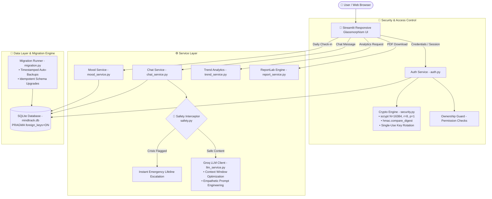
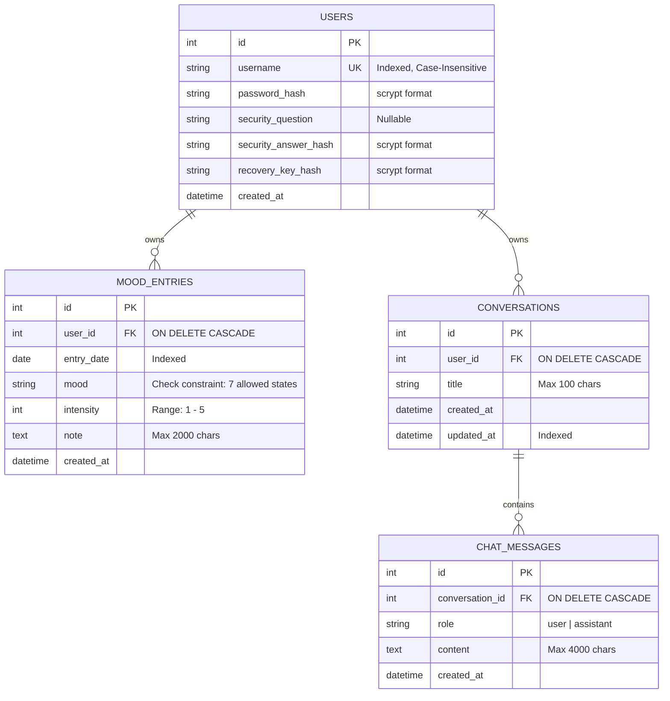

# 🌿 MindTrack AI

<div align="center">

[](https://www.python.org/)
[](https://streamlit.io/)
[](https://www.sqlalchemy.org/)
[](https://www.sqlite.org/)
[](https://groq.com/)
[](https://docs.pytest.org/)
[](https://github.com/astral-sh/ruff)
[](https://owasp.org/)

**A Production-Grade, Privacy-Centric Full-Stack AI Wellness & Mood Analytics Platform**

[Key Highlights](#-engineering-highlights) •
[System Architecture](#-system-architecture) •
[Security & Cryptography](#-security--cryptography-deep-dive) •
[Database Schema](#-database-schema--data-integrity) •
[Getting Started](#-getting-started) •
[Testing & QA](#-testing--quality-assurance) •
[Resume Ready Highlights](#-resume-bullet-points)

</div>

---

## 📌 Executive Overview

**MindTrack AI** is an enterprise-grade personal mental wellness and reflective journaling web platform. Built with Python, Streamlit, SQLAlchemy 2.0, SQLite, and Groq LLMs, the platform bridges private daily mood tracking with empathetic, context-aware conversational AI and longitudinal health analytics.

Designed with a **defense-in-depth security posture**, MindTrack AI features OWASP-recommended `scrypt` password hashing, strict per-user ownership and authorization enforcement, dual-path self-service account recovery (cryptographically hashed security questions and rotating single-use emergency recovery keys), zero-data-loss database schema migrations, and real-time deterministic crisis keyword interception.

---

## 🏛️ System Architecture

MindTrack AI adheres to clean decoupled layers: presentation, business logic services, security & crypto primitives, data persistence, and an asynchronous LLM gateway.



---

## 🚀 Engineering Highlights

### 1. 🛡️ Multi-Tenant Per-User Ownership & Authorization
- **Strict Tenant Isolation**: All records across `mood_entries`, `conversations`, and `chat_messages` are explicitly foreign-keyed to an authenticated `user_id`.
- **Query Scoping**: Data retrieval queries are strictly filtered at the database level (`where(Model.user_id == user_id)`), preventing unauthorized information leakage.
- **Defensive Mutation Checks**: Service functions verify caller ownership prior to any update or deletion. Unauthorized access attempts immediately raise explicit `PermissionError` exceptions.

### 2. 🔐 OWASP-Compliant Authentication & Password Recovery
- **State-of-the-Art Hashing**: Employs Python's native `hashlib.scrypt` with OWASP-recommended parameters ($N=16384$, $r=8$, $p=1$, $dklen=64$) and 16 bytes of cryptographically secure random entropy (`secrets.token_bytes(16)`).
- **Constant-Time Verification**: All credential matching is executed via `hmac.compare_digest` to eliminate side-channel timing attacks.
- **Dual-Path Account Recovery**:
  1. **Security Question & Answer**: Case-insensitive, whitespace-normalized answers stored as scrypt hashes with an interactive question lookup utility.
  2. **Emergency Recovery Key**: Provisions a 16-character token (`MT-XXXX-XXXX-XXXX`). Recovery keys are **single-use** and automatically rotated upon successful recovery.

### 3. 📦 Resilient Database Migration & Auto-Backup Engine
- **Zero-Loss Data Preserving**: Custom lightweight migration engine automatically inspects table schemas on startup.
- **Pre-Migration Snapshotting**: Creates timestamped backups (`mindtrack.backup_<timestamp>.db`) prior to running schema alterations.
- **Idempotency**: Safely verifies column existence before executing `ALTER TABLE` operations, guaranteeing idempotency in continuous deployment environments.

### 4. 🚨 Pre-Inference Safety Interceptor & Crisis Protocol
- **Deterministic Heuristic Detection**: Scans user prompts for self-harm and acute crisis indicators using specialized regex pattern matchers with negation handling (`I don't want to die` vs `I want to die`).
- **Immediate Lifeline Escalation**: Bypasses LLM inference on crisis detection to serve verified national and international helpline resources instantly, ensuring responsible AI deployment.

### 5. 📊 Longitudinal Mood Analytics & Reporting
- **Trend Computation**: Calculates rolling intensity trends, weekday averages, frequency heatmaps, and sentiment distribution using Pandas and Plotly Express.
- **Dynamic PDF Generation**: Compiles publication-ready A4 reports via ReportLab, complete with summary metrics, styled tables, vector bar charts, and disclaimers.

---

## 🛠️ Tech Stack Breakdown

| Layer | Technologies | Purpose |
| :--- | :--- | :--- |
| **Frontend UI** | Streamlit, HTML5, CSS3 Glassmorphism | Responsive wellness interface, custom typography, tab routing |
| **Data Visualization** | Plotly Express, Matplotlib | Dynamic intensity charts, distribution donuts, rolling averages |
| **Backend & ORM** | Python 3.14+, SQLAlchemy 2.0 (Declarative Base) | Clean domain modeling, scoped session management, relationship mapping |
| **Database** | SQLite 3 (`PRAGMA foreign_keys=ON`) | Embedded zero-configuration persistence with relational integrity |
| **AI / LLM Integration** | Groq API (`llama-3.3-70b-versatile` / OpenAI SDK) | Empathetic mental wellness reflection companion with context buffering |
| **Cryptography** | `hashlib.scrypt`, `hmac`, `secrets` | OWASP-standard credential hashing and key generation |
| **Document Generation** | ReportLab 5.0 | Dynamic tabular and graphical PDF mood summaries |
| **Testing & Tooling** | Pytest, Ruff, `uv` Package Manager | Ephemeral database fixtures, PEP 8 / Ruff linter, fast dependency resolution |

---

## 🗄️ Database Schema & Data Integrity



---

## 🔒 Security & Cryptography Deep Dive

MindTrack AI adheres to modern application security best practices:

```
Stored Hash Format:
scrypt$16384$8$1$<16_byte_hex_salt>$<64_byte_derived_hex_key>
```

- **CPU/Memory Cost ($N=16384$, $r=8$, $p=1$)**: Requires substantial RAM per calculation, drastically driving up GPU/ASIC hardware costs for brute-force attacks.
- **Salt Entropy**: Every password and security answer receives an independent, cryptographically secure 16-byte random salt generated by OS entropy (`secrets.token_bytes(16)`), making rainbow table attacks infeasible.
- **Timing Attack Resistance**: All hash validations compare hex strings using `hmac.compare_digest(computed, expected)`, guaranteeing constant-time execution regardless of match length.
- **Single-Use Key Rotation**: When an emergency recovery key is consumed, the system immediately generates, hashes, and stores a fresh key while invalidating the old one.

---

## 🏁 Getting Started

### Prerequisites
- **Python 3.14+**
- **uv** (recommended) or **pip**
- **Groq API Key** (for conversational AI companion)

### 1. Clone the Repository
```bash
git clone https://github.com/PrashantByte-28/mindtrack-ai.git
cd mindtrack-ai
```

### 2. Environment Configuration
Create a `.env` file in the project root:
```env
GROQ_API_KEY=your_groq_api_key_here
```

### 3. Install Dependencies
Using **uv** (recommended for ultra-fast setup):
```bash
uv sync
```
Or with standard virtualenv & pip:
```bash
python -m venv .venv
source .venv/bin/activate  # On Windows: .venv\Scripts\activate
pip install -r requirements.txt
```

### 4. Run the Application
```bash
uv run streamlit run app.py
```
*(or via active virtualenv: `streamlit run app.py`)*

Access the application in your browser at `http://localhost:8501`.

---

## 🧪 Testing & Quality Assurance

The codebase includes an automated test suite executed with **Pytest**, utilizing custom fixtures (`tests/conftest.py`) that create ephemeral in-memory/temporary SQLite databases for every test invocation to guarantee test isolation.

### Run Test Suite
```bash
uv run pytest -v
```

### Test Coverage Highlights
- ✅ **`tests/test_auth.py`**: Password hashing, salt uniqueness, username/password constraints, account creation, credential updates, security question validation, and single-use recovery key rotation.
- ✅ **`tests/test_ownership.py`**: Multi-tenant authorization boundaries, verifying cross-user reads, message postings, and deletions strictly raise `PermissionError`.
- ✅ **`tests/test_migration.py`**: Zero-loss schema migration engine, validating automatic backup file creation, idempotent upgrades, and legacy orphan data association.
- ✅ **`tests/test_safety.py`**: Deterministic crisis pattern detector, verifying proper negation handling and safety keyword escalation.
- ✅ **`tests/test_chat_storage.py`**: Multi-turn conversation persistence, cascading deletions, and title auto-generation.

### Code Style & Linting
Enforced using **Ruff**:
```bash
uv run ruff check src tests app.py
```

---

## 💼 Resume Bullet Points

Looking to showcase this project on your software engineering resume? Here are impact-focused bullet points:

- **Full-Stack Architecture & Development**:
  > *"Architected a responsive AI mental wellness platform using Python, Streamlit, SQLAlchemy 2.0, and SQLite, handling multi-user check-ins, longitudinal mood analytics, and multi-turn conversational support."*

- **Defense-in-Depth Application Security**:
  > *"Engineered an OWASP-compliant security architecture featuring scrypt password hashing ($N=16384$), constant-time digest verification, and a dual-method account recovery engine with single-use self-rotating recovery keys."*

- **Data Integrity & Resilient Migrations**:
  > *"Built an idempotent, zero-data-loss SQLite migration engine with automated timestamped database snapshotting and relational cascade enforcement across multi-tenant user entities."*

- **AI Safety & LLM Integration**:
  > *"Integrated Groq's high-throughput LLM API with optimized 12-message sliding context windows, paired with a pre-inference regex/heuristic safety interceptor to route crisis queries to emergency lifelines."*

- **Data Analytics & Automated Reporting**:
  > *"Developed rolling trend analysis pipelines with Pandas and Plotly, and built a dynamic document generation service using ReportLab to export formatted, vector-graphed A4 PDF health reports."*

---

## 📄 License & Attribution

Developed with care by **[Prashant Mishra](https://github.com/PrashantByte-28)**.

*Disclaimer: MindTrack AI is an exploratory wellness reflection companion and is not intended to serve as a diagnostic clinical tool or a substitute for professional mental healthcare.*
